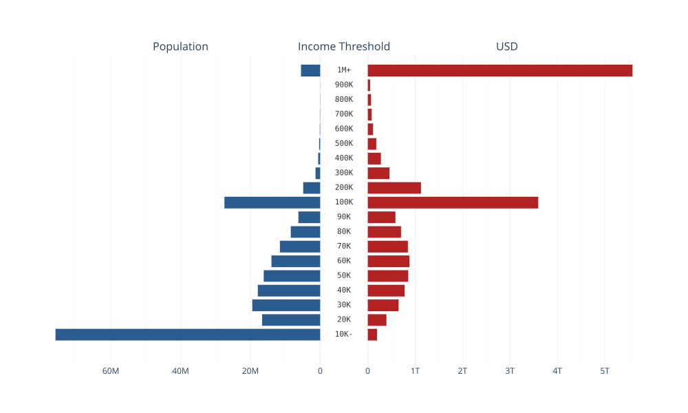
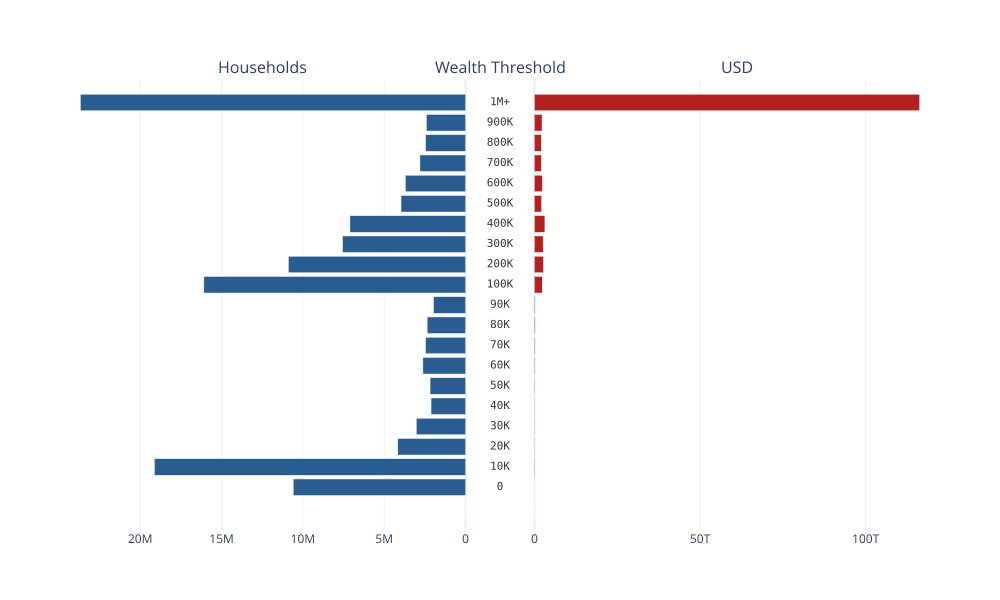

# Where Is the Money
A brief overview of U.S. Financial data

---

### 2026 Quick Financial Stats
| Category | Official Value | Percentage
| :--- | :--- | :---|
| [Federal Revenue](https://fiscaldata.treasury.gov/americas-finance-guide/government-revenue/) | $5.40 Trillion | 100% |
| - [Federal Debt](https://fiscaldata.treasury.gov/americas-finance-guide/national-debt/) | $40.40 Trillion | 748% |
| - [Federal Deficit](https://fiscaldata.treasury.gov/americas-finance-guide/national-deficit/) | $2.00 Trillion | 37% |
| [Federal Budget Spending](https://fiscaldata.treasury.gov/americas-finance-guide/federal-spending/) | $7.40 Trillion | 100% |
| - [Medicare & Health Spending](https://fiscaldata.treasury.gov/americas-finance-guide/federal-spending/) | ~$2.15 Trillion | 29% |
| - [Social Security Spending](https://fiscaldata.treasury.gov/americas-finance-guide/federal-spending/) | ~$1.70 Trillion | 23% |
| - [Net Interest Spending](https://fiscaldata.treasury.gov/americas-finance-guide/federal-spending/) | ~$1.04 Trillion | 14% |
| - [Defense Spending](https://fiscaldata.treasury.gov/americas-finance-guide/federal-spending/) | ~$962 Billion | 13% |
| [Personal Income](https://www.bea.gov/news/2026/personal-income-and-outlays-august-2026) | $27.60 Trillion (SAAR) | 100% |
| - [Personal Savings](https://www.bea.gov/news/2026/personal-income-and-outlays-august-2026) | $1.02 Trillion (SAAR) | 4% |
| [Total Household Wealth](https://fred.stlouisfed.org/series/BOGZ1FL192090005Q) | $185.65 Trillion | 100% |
| - [Owner-Occupied Real Estate Wealth](https://fred.stlouisfed.org/series/BOGZ1FL155035013Q) | $47.89 Trillion | 26% |
| - [Direct & Indirect Stock Wealth](https://fred.stlouisfed.org/series/BOGZ1LM153064475Q) | $74.03 Trillion | 40% |

---

### Earned Income Distribution: Population & Dollar Volume

**Source:** [2025 Census data](https://www.census.gov/data/datasets/time-series/demo/cps/cps-asec.2025.html#list-tab-165711867)

 - **Bin Range Logic:** Spans from lower bound to upper bound minus $1 (e.g., $10,000 to $19,999).
- `10K-` Indicates $10,000 and less.
- `1M+` Indicates $1,000,000 and greater.

---

### Wealth Distribution: Household & Dollar Volume

**Source:** [2022 Survey of Consumer Finance data](https://www.federalreserve.gov/econres/scfindex.htm)  
 - **Bin Range Logic:** Spans from lower bound to upper bound minus $1 (e.g., $10,000 to $19,999).
- `1M+` Indicates $1,000,000 and greater.

---

#### Data Discrepancies and Notes
- Income Salary bands and USD levels were derived from 2025 census data
  - Census applies obfuscation on high earners to secure privacy, and original values were under $1 trillion
  - The top earner bin was replaced with  the population level ~5M times the bin's dollar value of $1M

### Methods
#### Census
- Sum WSAL_VAL, SEMP_VAL, and FRSE_VAL (wages, self-employed wages and farm wages respectively) and set to variable `usd`
- Associate MARSUPWT with variable `population` and divide by 100
  - Division by 100 is a compensation for census weighting methods
- Remove individuals with no income
- Create income bins with `log_lin_bin()`
  - See transform.py
- Multiply `usd` by `population` to get total volume of dollars for a given bin on a given row
- Aggregate sum of `usd` and `population` by income bin
- Adjust upper `1M+` bin to account for census obfuscation

#### Survey of consumer finances
- Set NETWORTH field to variable `usd`
- Set WGT field to variable `population`
- Create wealth bins with `log_lin_bin()
  - See transform.py
- Aggregate sum of `usd` and `population` by wealth bin